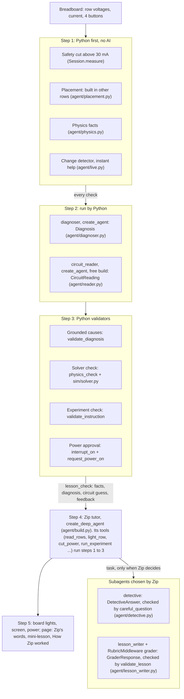

# Genesis: Smart Breadboard

An electric circuit teaching board for middle school students. The
breadboard measures its own circuit. An AI agent reads the
measurements, cuts power on unsafe mistakes, and teaches with hints.
After every mistake the laptop shows a short mini-lesson about the
idea behind that mistake, with a one-question quiz.

The real board is **the station**, built in
[jinglebells2020/smartboard](https://github.com/jinglebells2020/smartboard)
(`docs/HARDWARE.md`): an ESP32-S3 that measures every breadboard row, a
light strip on each side, a StickS3 screen and four coloured buttons
(yellow check, white hint, blue next step, red power). **Its breadboard
runs on 3.3 V**, so every lesson is written for 3.3 V, and it has no
current sensor and no power switch: when a circuit is dangerous, Genesis
tells the student to pull the red wire out of the + line. Everything
also works with the fake board, without hardware.

## Target user

Middle school students, ages 11 to 14, building their first circuits.
When something is wrong they need to learn *why*, in plain words, not
just hear "wrong" or be handed the answer. All text a student sees is
written at about a 6th grade reading level.

## What works today

| Part                     | Status                                        |
|--------------------------|-----------------------------------------------|
| `sim/fake_board.py`      | Done. Speaks serial protocol version 2. Simulates lessons 0 to 4 (lesson 4's push button held or let go with `HOLD on|off`), every listed mistake (including a loose leg that flickers), two unlisted ones, a part plugged into a row outside the plan (`stray_part`) and 1 to 3 copies of a circuit (`COPIES T0 T15 B0`). Starts with any rows, with or without a current sensor, power switch or screen, on a 3.3 V supply like the station (`--supply` for another) |
| `lessons/*.json`         | Done for lesson 0 (how a breadboard connects: tap holes, one question), lessons 1 and 2, lesson 3 "More LEDs" (the LED circuit with a 330 ohm resistor, built 1 to 3 times anywhere; each copy is checked, and with three the total current must be about 3 x 3.9 = 11.7 mA), and lesson 4 "Button switch" (two guided steps: hold the button and check, then let go and check; each step has its own rules and mistakes): 22 mistakes, each with a hint, full explanation and mini-lesson (idea + quiz question). Any other mistake gets a clue from the numbers. All numbers, ranges and texts are for the station's 3.3 V, and allow its meter (±0.1 V, the top of its range read as the supply) |
| `docs/SERIAL_PROTOCOL.md`| Done, version 2: a voltage per row, empty rows, current (or null), row lights with colors, screen text, 4 buttons |
| `protocol.py`            | Done. Row names, light colors, button meanings and the station's button colours, the supply voltage (`SUPPLY_V = 3.3`; a board's hello line can say its own `supply_v`), what "switch the power off by hand" means on the station, and screen size, in one place |
| `agent/`                 | Done. deepagents tutor with the CLAUDE.md tools. Uses Claude when ANTHROPIC_API_KEY is set, an offline mock otherwise |
| `agent/placement.py` | Done. Build anywhere: the same circuit built in other rows (or the bottom half) is found and checked there (agent/placement.py). Any spacing too: parts may span a different number of rows than the lesson (resistor in rows 20 to 27, LED in 27 to 29), even built the other way round. The exact spacing is tried first. |
| `agent/physics.py`, `agent/diagnoser.py` | Done. AI diagnoser: plain Python works out physics facts from each check (row voltages, the voltage across each part, the current through each resistor, LED on/blocked/shorted, rows that read the same, extra rows, loose legs, power). With Claude, the diagnoser subagent reasons from those facts and names the facts behind every cause; plain Python drops any cause the facts do not show. Safety, power and passing are still decided by plain Python and the lesson's rules. Offline, nothing changes. |
| `agent/live.py` | Done. Instant help (on by default; `--no-instant` or the "Instant help" switch turns it off): Zip reacts the moment the board changes, without Check. A change counts after it stays 1.5 s. While building it stays quiet ("2 of 4 parts in" under the plan); a mistake that is already clear (a part outside the plan, a shorted LED, joined rows, a loose leg, far too much current) is said at once, then Zip explains it with a normal check; a fix gets "That fixed it."; a finished circuit is checked and passed as usual. After a pass, instant help waits for the board to change (the pretend board starts the next lesson empty), so it never passes two lessons on the same board. |
| `agent/experiments.py` | Done. Zip acts: when two causes look the same to the board, Zip can ask you to do ONE thing with your hands ("Turn around the LED in rows 10 and 12"), with two buttons ("Done" / "I can't"), then measures again and sees what changed. Python checks the instruction first (one action from: pull out, push in, turn around, move, press, let go, wait; a part of the lesson; a row; never anything about power) and allows at most 2 per reply. While you build, each part you add makes Zip light the next part's rows blue and write the step on the board screen, without a chat message. Zip may switch the power off at any time and must say why; it can never switch power on by itself (that still asks "Turn the power back on?"). |
| `agent/activity.py` | Done. Agent activity: a live panel for judges (closed for the student, opens with the Teacher view) listing the last 50 actions of Zip's agents, newest first, with who did it, the kind of action and the time, and counts per agent. Built from the same recorded steps as "How Zip worked", plus instant help and plain-Python safety cuts. It only reads: nothing about what Zip does changes. |
| `sim/solver.py`, free build (phase 1) | Done. **Usable rows**: `--usable-rows "T3-T8,T20-T24,B40-B45"` (or the `SMART_BOARD_USABLE_ROWS` environment variable; default every row) for a board where only some rows work: the others are never measured, never called empty, never lit, and are grey in the drawing. **Circuit solver**: the fake board works out any circuit (wires, resistors, LEDs of 5 colours, push buttons) with nodal analysis, so a free build reads like a real board. **Random judge circuits** (`/api/random-circuit`), sometimes with a typical mistake (LED backwards, missing link, short, LED with no resistor: the safety cut still works). **Parts tray** ("What parts did you use?" and "What should it do?"). **Free build** (`--free-build`): after lesson 4 in the path, no plan, the check reports every measured row, the current and plain facts. The AI that works out what was built comes in phase 2. |
| `agent/reader.py`, `agent/feedback.py`, free build (phase 2) | Done. In free build, every check reads ANY circuit: plain Python works out the facts, the **circuit reader** (a Claude subagent; offline, a plain-Python reader for one chain of parts) guesses which parts are on which rows, and a **physics check** in plain Python works the guess out with `sim/solver.py` and compares it with every measured row (within 0.3 V) and the current (within 20 % or 1 mA). If it does not match, the reader is told what did not match and tries once more; the best guess is kept. Then Zip gives feedback, hint first: is each LED on and why, shorts, parts doing nothing, open paths, the current, and whether the circuit does what the student wanted. Red, yellow and green lights only on usable rows. When the guess does not fit, Zip says honestly that it is not sure and asks about the parts tray. The page shows **"Zip thinks you built:"** with a check mark for each part the physics check confirmed. |
| `agent/planner.py`, free build (several hypotheses) | Done. When no current flows, several circuits can read the same: the circuit reader gives up to 3; every one that matches every usable row is kept and ranked in Python (all rows with a voltage explained, tray parts used, a usual mistake before invisible wires). The planner simulates every allowed action on each with the solver and picks the one that tells them apart (preferring one that really fixes the most likely problem, never an unsafe one); after the student does it, the one that came true is kept and Zip names its problem, hint first. |
| LangSmith tracing (optional) | Done. Off by default. Set `LANGSMITH_TRACING=true`, `LANGSMITH_API_KEY` and `LANGSMITH_PROJECT=genesis` (RUN.md Part H) and every run, tool and subagent shows on smith.langchain.com; the server prints "LangSmith tracing: on (project genesis)". No extra install: `langsmith` comes with LangChain. |
| `agent/serial_board.py`  | Done. Talks to a real board on a USB serial port (pyserial). Survives junk lines, a missing hello, the cable being unplugged and plugged back, and silence. Use it with `--serial COM3` (or `--serial auto`, which picks the station's ESP32-S3 port, USB vendor id 0x303A, when there are several) |
| `tools/check_board.py`   | Done. Checks a board's firmware against the protocol and prints PASS or FAIL per rule. How the hardware teammate tests the firmware (docs/FIRMWARE_GUIDE.md) |
| Station firmware         | Done, in jinglebells2020/smartboard: `firmware/smartboard_s3` starts in Genesis mode (protocol version 2) and must pass `tools/check_board.py`. docs/FIRMWARE_GUIDE.md says what any board's firmware must do |
| `web/`                   | Done. Projector page made for an 11-year-old: Zip the guide with 4 moods, a drawn plan of the breadboard with the parts and live row lights, a lesson path with stars, a pop-up mini-lesson with quiz, a short celebration, a pretend board (screen + 4 buttons) with the fake board, and a Teacher drawer (`python web/server.py`) |

## Folders

- `docs/` : plans. TRACKS, HARDWARE, LESSONS, SERIAL_PROTOCOL, and
  FIRMWARE_GUIDE (for the hardware teammate).
- `lessons/` : one JSON file per lesson: expected values, the accept
  range, how to spot each mistake, and what to teach for it.
- `protocol.py` : the shared names and rules of the serial protocol.
- `sim/fake_board.py` : pretends to be the board. `sim/fake_port.py`
  pretends to be a serial port with the fake board on it (for tests).
- `tools/check_board.py` : checks a real board's firmware.
- `agent/` : the deepagents tutor (see agent/README.md), with the
  detective subagent and the student notebook.
- `notebooks/` : one notebook per student. Made when the tutor runs;
  never committed (it is about real students).
- `tests/` : automatic checks for the simulator, the agent and the web page.
- `web/` : the projector page and its small local server.
- `firmware/` : a pointer. The station's firmware lives in
  jinglebells2020/smartboard (`firmware/smartboard_s3`).

## Setup (step by step)

**Windows: follow [RUN.md](RUN.md)**. It has every click and command.

Mac or Linux, from inside the `smart-board` folder:

```bash
python3 -m venv .venv
```

```bash
source .venv/bin/activate
```

```bash
pip install -r requirements.txt
```

## Run the tests

```bash
python -m unittest -v
```

The last line should say `OK` (640 tests; it says `OK (skipped=1)` on a
computer without Node.js and Playwright, which the page-layout browser
check needs). They never call Claude, so
they work without an API key.

## Run the projector page

```bash
python web/server.py --fresh
```

Then open http://localhost:8000.

## Free build (phase 1)

Build anything with random parts, on a board where only some rows work:

```bash
python web/server.py --free-build --usable-rows "T3-T8,T20-T24,B40-B45" --fresh
```

- The page opens on **Free build** (the last stop in the lesson path,
  after lesson 4). The drawing shows only the rows that work; the others
  are grey.
- To give a judge a random circuit on the pretend board, run this in a
  second Command Prompt window (any seed number, 2 to 5 parts):

  ```bash
  curl -X POST http://localhost:8000/api/random-circuit -H "Content-Type: application/json" -d "{\"seed\": 7, \"parts\": 4}"
  ```

  The answer shows the true circuit, for you only: Zip never sees it.
  Then press **Check my circuit**: Zip says what the board measured.
- Fill in **What parts did you use?** and **What should it do?**, then
  press **Save my parts**. Zip uses them to tell apart circuits that read
  the same, and says whether the circuit does what you wanted.
- Under the drawing, **Zip thinks you built:** lists the parts Zip worked
  out, with a check mark for each one a circuit solver confirmed.

How well does Zip read random circuits? Run (no API key: the offline
reader; with `ANTHROPIC_API_KEY` set: Claude):

```bash
python tools/eval_free_build.py --n 40
```

It prints, for N random circuits: how often the guess passes the physics
check, how often the guessed parts are exactly right, and how often the
main problem was found. Add `--tray` to fill the parts tray like a
student would (push buttons are held pressed). Offline (plain Python, 80
circuits): 89% pass the physics check, 54% exactly the right parts (71%
with the tray), 85% main problem found. Two LEDs side by side can read
like one chain to the board, so "passes physics" does not always mean
"right parts".

**When no current flows, several circuits read the same.** An LED in
backwards, an LED whose leg missed its row, and "two wires" can all give
the same voltages. So the circuit reader gives up to 3 possible circuits;
each is checked with the solver against every usable row: a row with a
voltage must be explained, and a row the board reads empty must stay
empty (so a guess that puts parts in empty rows fails). Python ranks the
ones that fit: those that explain every row with a voltage first, then
every tray part used, and a usual student mistake (LED backwards, a
missing link, a push button not pressed) before invisible extra wires.
Zip names the most likely problem, hint first ("the LED between row 45
and the - line is blocking the current: which way does its long leg
go?"), and suggests one experiment, planned in plain Python
(`agent/planner.py`): it tries every allowed action (turn around a part,
press or let go of a button, pull a part out, move a leg) on every
possible circuit with the solver, and picks the one whose results differ
most; when two are equally good, the one that would fix the most likely
problem (and never one about a part in a row that reads empty). After you do it and press **Done**, Python compares what changed
with each prediction and keeps the circuit that came true.

## Start the demo (one command)

```bash
python web/server.py --demo
```

It starts fresh: student **Maya**, **lesson 1**, an empty mistake
history and a new notebook, and prints the demo URL
(http://localhost:8000). To start over for the next judge: **Teacher →
Restart demo**. Step by step for Windows: RUN.md Part G.

**Safe if the internet fails.** If a call to Claude fails, takes more
than 60 seconds, or there is no internet, the offline tutor answers that
one message and the page says **"Zip is in offline mode for this
answer"** under Zip's words. The next message tries Claude again.
Safety and hints never depend on Claude: power cuts, power only when
the student asks, measuring right after power comes on, and the hint
button are plain Python. A Claude reply that failed halfway is undone
first (the teaching state, not the power), so nothing is counted twice
(`agent/fallback.py`). The server window prints one line per Claude
reply with how long it took:

```
[14:05:12] Claude reply took 6.4 s
[14:06:40] Claude failed after 0.5 s (could not reach Claude: is the internet connected?). The offline tutor answered this message; the next one tries Claude again.
```

## Use the real station

The station is the real board (`docs/HARDWARE.md`). Do these in order the
first time (the steps for the station are in jinglebells2020/smartboard):

1. **Mux test.** Walk every breadboard row with `tools/mux_test` there. It
   saves `as_built_map.json`: which wire is which row.
2. **Make the row map** there:
   `python3 tools/make_fw_maps.py tools/mux_test/as_built_map.json`.
3. **Flash** `firmware/smartboard_s3` from the Arduino IDE.
4. **Plug the station in** with its USB-C cable (the S3's own USB port),
   then check it from this repository (Windows steps in RUN.md Part F):

   ```bash
   python tools/check_board.py --serial auto
   ```

5. **Start Genesis on it:**

   ```bash
   python web/server.py --fresh --serial auto
   ```

`--serial auto` picks the station's port by itself (USB vendor id 0x303A),
even with other serial devices plugged in; otherwise give its name
(`COM3`, `/dev/ttyACM0`). The baud rate does not matter on the S3's USB
port (`--baud` is for other boards; default 115200). A line at the top of
the page says "Board connected on COM3" or, in red, "Board not answering".
Without `--serial` the fake board is used.

**3.3 V.** The station's breadboard runs on 3.3 V, and every lesson is
written for it (5.9 mA through lesson 1's LED, 1.65 V in the middle of
lesson 2). Use red, yellow or green LEDs: a blue or white one barely
lights at 3.3 V. The station has no power switch: the red button, and any
dangerous circuit, makes Genesis say "pull the red wire out of the + line"
on the laptop and on the station's screen. Before the row map is flashed
the station measures no named rows, and Genesis says it cannot check the
lesson yet.

## Run the tutor in a terminal

```bash
python -m agent --fresh
```

Without ANTHROPIC_API_KEY it uses an offline practice tutor. With the
key set it uses Claude (`claude-opus-5-5`; change it with
SMART_BOARD_MODEL). See RUN.md Part C for what to type.

## Try the simulator by hand

See every circuit it can pretend to be:

```bash
python3 sim/fake_board.py --list
```

Run lesson 1 with the LED in backwards:

```bash
python3 sim/fake_board.py --lesson 1 --scenario led_backwards
```

The first line is the `hello` line (what this board has). Then readings
scroll by, about 10 per second (the rate is not fixed: each reading has
`t_ms`). While they scroll, type a command and press Enter, for example
`LED T10 red`, `LED CLEAR`, `SHOW Hello|world`, `PRESS 1`, `CUT`,
`RESTORE` or `SCENARIO 1 correct`. Press Ctrl+C to stop.

Free build: any circuit, given as a list of parts (a netlist). The LED's
long leg is its first row:

```bash
python3 sim/fake_board.py --lesson 5
```

then type (all on one line) and press Enter:

```
NETLIST [{"kind": "wire", "rows": ["PT+", "T5"]}, {"kind": "resistor", "rows": ["T5", "T10"], "ohms": 220}, {"kind": "led", "rows": ["T10", "T12"], "color": "red"}, {"kind": "wire", "rows": ["T12", "PT-"]}]
```

The readings now show about 6 mA (3.3 V, like the station). `NETLIST CLEAR` empties the board again.

Try a board with only 16 rows, no current sensor and no power switch:

```bash
python3 sim/fake_board.py --rows T1-T16 --no-current --no-power-switch
```

## The page

Made for an 11-year-old: bright, friendly, never scary, with our own
characters and colours. It feels like a bright creative studio: white
work surfaces on a light blue-grey page, five colours with one job each
(blue: top bar and main buttons; yellow: highlights, stars and Zip;
green: correct; coral: problem here; sky blue: "put a part here"),
big rounded buttons, and text that always has strong contrast. The
design rules are checked by tests (`tests/test_page_design.py`).

Three zones fill the screen:

- **Top bar**: the lesson, the lesson path with stars, the power sign
  and the **Teacher** button.
- **The plan: where each part goes** (the stage): a drawing of the
  lesson's rows with each part where the lesson puts it, the row
  lights in their colours (red ones gently pulse: "look here", not
  "you failed") and each row's voltage in small text. The current and
  the power voltage are small pills on top; the pretend board (screen
  and 4 buttons, in the station's colours: yellow check, white hint,
  blue next step, red power) sits underneath. Parts are drawn in their real
  colours (red wire, black wire, tan resistor with its colour bands,
  red LED).
- In lesson 0 there is nothing to build: **tap any hole** in the
  drawing and every hole joined to it lights up yellow (its row half,
  a to e or f to j, or a whole + or − line), with a sentence saying
  why. The LED is always drawn with a **+** by its long leg and a flat
  side by its short leg; when the LED is backwards, a yellow ring points
  at the long leg.
- After a mistake, a **Learn why** tab appears under Zip's words; it
  opens the mini-lesson in Zip's panel, in place of Zip's picture, so it
  never covers the breadboard, the numbers or Zip's words.
- Every mini-lesson card has a **Show the class** button: the
  mini-lesson becomes one full-screen slide (big title, the idea, a
  drawing of the lesson's parts, the question) that can be read from
  the back of a room. **Esc** closes it.
- **Zip**, our robot spark guide, says the tutor's words in a speech
  bubble. 4 faces: happy (correct), thinking (checking), curious (a
  hint or a question) and careful (danger or power off). Below Zip:
  **Check my circuit**, **I fixed it** and a box to ask anything.
- **Lesson path with stars**: 1 star for passing a lesson, a 2nd with
  no mistake made twice, a 3rd when every mini-lesson question in it
  was answered right. Worked out from the history; no new rules.
- A short **celebration** when a circuit is correct: the rows glow
  green, a little confetti, Zip bounces. No sound.
- **Teacher drawer** (closed when the page opens, slides in over Zip):
  practice mode, board status, New student, Restart demo, the notebook link, what the
  tutor did, and the mistake history.

One HTML file, no internet. On a 1920x1080 screen everything fits without
scrolling. On shorter laptop windows (from 1280x560) the page scrolls
instead of squeezing: the breadboard drawing keeps at least 300 px of
height, Zip's words show at least 4 lines, and nothing overlaps
(checked in a real browser by `tests/test_page_layout.py`). It also has
a phone layout.

## Demo script

Works today with the fake board. Start it with
`python web/server.py --demo` (Maya at lesson 1; for step 0 use
`python web/server.py --fresh`, which starts a new student at lesson 0).
Clicks are in RUN.md Part E. The
**pretend board** (under the drawing) has the board's screen and its 4
buttons. Pick circuits in **Teacher → Practice mode**.

0. A new student starts at **lesson 0, How a breadboard connects**.
   Tap row 6 in the drawing: 5 holes light up ("row 6, holes a to e:
   these 5 holes are joined by one metal clip"). Tap the top + line:
   the whole line lights. Press **Learn**, then **Show the class** to
   put the question on the projector; Esc closes it. Answer the
   question, press **Check my circuit**, and Zip moves on to lesson 1.
1. Build step by step: press the blue **Next step** button. The drawing
   shows the red wire strong and the rest faint, row 5 lights blue and the
   screen says "Step 1 of 4 / Red wire". Keep pressing it: resistor, LED
   (long leg row 10, short leg row 12), black wire.
2. LED backwards, then the yellow **Check my circuit** → Zip thinks, then
   looks curious. Rows 10 and 12 glow red, Zip gives a hint (not the
   answer), and the card "LEDs are one-way doors" appears with a quiz
   question. Answer it: right or wrong, the page says why.
   A ring in the drawing points at the LED's long leg (marked +).
   Practice mode **Loose LED leg**, then yellow → row 10 keeps switching
   between connected and empty, so it lights yellow and Zip says "push
   that leg in firmly". Card: "Loose legs make blinking circuits".
3. The white **I need a hint** → the next level of help: the full
   explanation. The hint button never measures, never changes power and
   never adds a mistake to the history.
4. No resistor, then yellow → power is cut at once, Zip looks careful (a
   friendly yellow sign) and asks what keeps the current small. Card:
   "Resistors keep current small". Press the red **Power off / on** before fixing it: power
   comes on, is measured at once, and goes off again ("still not safe:
   100 mA flowed").
5. Correct circuit, then **I fixed it** → power back on, all rows
   green, the LED in the drawing glows, Zip is happy and bounces,
   confetti falls, and lesson 1 gets its stars on the path. On to
   lesson 2. (Make the same mistake twice in one lesson and the tutor
   asks for that lesson once more.)
6. A mistake on no list ("Not on the list: 4.7k bottom resistor") → Zip
   still explains with a clue from the row voltages, lights that row
   yellow (careful), and then asks the **detective**, which answers
   with at most two questions ("Could the bottom 10k resistor be a
   different value than the plan says...?"). In the Teacher drawer, "What the
   tutor did" says "asked the detective, wrote in the notebook", and
   **Open the student's notebook** shows the line it just wrote.
7. Restart with `--no-power-switch --no-current --rows T1-T16` (like the
   station, on fewer rows): the same lessons still work. No resistor now
   puts "DANGER! / Pull the red wire / out of the + line / right now!" on
   the board screen, Zip says to pull the red wire out of the + line, and
   the current shows as "worked out from the rows".

## How we use deepagents

**AI decides, physics verifies, Python guards.**

Genesis is built for the LangChain "Best use of deepagents" track. The
tutor, Zip, is one `create_deep_agent`. Around it, plain Python measures
the board and keeps it safe, more agents (some called by Zip, some
called by Python on every check) do the reasoning, and plain Python
checks every AI answer before a student sees it. Real Claude is not
needed to see the machinery: offline, scripted models run the same
deepagents loop, so the 640 tests exercise the real thing.



### Every deepagents / LangChain feature we use

| Feature | Where | What it does in Genesis |
|---|---|---|
| `create_deep_agent` | `agent/build.py` (`build_agent`) | Zip, the tutor: system prompt, the board tools, two subagents, the student's notebook as memory, our middleware and the power approval, in one agent. |
| Subagents through the `task` tool | `agent/detective.py` (`detective_spec`, a SubAgent), `agent/lesson_writer.py` (`lesson_writer_spec`, a CompiledSubAgent) | Zip calls them only when needed: the detective for a mistake no lesson lists, the lesson writer when the same mistake comes back or a quiz was answered wrong. Each runs in its own context with one read-only tool, so Zip's conversation stays short. |
| `create_agent` | `agent/diagnoser.py` (`make_diagnoser`), `agent/reader.py` (`make_reader`), `agent/lesson_writer.py` | The diagnoser and the circuit reader, built from SubAgent-shaped specs and run by Python on every check; and the lesson writer's own agent, which carries the grader. |
| Structured output (`response_format`, plain pydantic schemas, not ToolStrategy) | `DetectiveAnswer` (`agent/detective.py`), `Diagnosis` (`agent/diagnoser.py`), `CircuitReading` (`agent/reader.py`), `GraderResponse` (RubricMiddleware's grader) | Every AI answer comes back as fields Python can check: at most two causes as questions, causes that cite fact ids, up to 3 circuits with parts on rows, a grade per rubric rule. |
| Memory (`memory=[...]`) | `agent/build.py`, `agent/notebook.py` | One notebook per student, loaded at the start of every reply, so Zip remembers a student between days. Zip adds one line after each check with its own `edit_file` tool. |
| `CompositeBackend`, `FilesystemBackend`, `StateBackend`, `FilesystemPermission` | `agent/notebook.py` (`notebook_tools_backend`) | Files under `/notebook/` are real files in `notebooks/` (FilesystemBackend); everything else lives only in the agent's state (StateBackend). Permissions let Zip read and write this student's notebook and write nothing else. |
| `interrupt_on` + `InMemorySaver` (human in the loop) | `agent/build.py` (`ask`, `answer_power`, `answer_experiment`), `agent/tools.py` (`run_experiment`) | Before `restore_power` the run pauses and the page asks **"Turn the power back on?"**. Experiments pause the same way with LangGraph's `interrupt()` inside the tool ("Turn around the LED in row 45 ..." with **Done** / **I can't**). Both resume with `Command(resume=...)` on the same checkpointer. |
| `RubricMiddleware` | `agent/lesson_writer.py` | A grader agent checks each new mini-lesson against a rubric (3 short sentences, 6th grade words, never the fix, 3 options with 1 right) and sends it back for another try (at most 2 rounds). `on_evaluation` records each grade. |
| Custom `AgentMiddleware` | `agent/trace.py` (`TraceMiddleware`, `DetectiveGuard`) | `TraceMiddleware.wrap_tool_call` records every tool call of Zip and of each subagent for "How Zip worked" and the Agent activity panel; its `wrap_model_call` stops a reply that was given up on (too slow). `DetectiveGuard` answers a `task` call to the detective in Python when the diagnosis already explains the check (saves a slow call). |
| `init_chat_model` | `agent/build.py`, `tools/eval_free_build.py` | Claude from `ANTHROPIC_API_KEY`, with a timeout per call and one retry. If Claude fails or is slow, the offline tutor answers that one message (`agent/fallback.py`). |
| LangSmith tracing (optional) | environment variables only (RUN.md Part H) | `LANGSMITH_TRACING=true` shows every run, tool and subagent on smith.langchain.com. Off by default. |

### Who decides when an agent runs

- **The diagnoser and the circuit reader are run by Python on every
  check**, not offered to Zip as tools. They are the core of every check,
  so they must never be skipped or asked twice. They also run *after* the
  safety cut, so a slow answer never delays it. Their answers are
  grounded before anyone sees them: every cause must cite real fact ids
  (`validate_diagnosis`), and every circuit guess is worked out with a
  circuit solver and compared with every usable row and the current
  (`physics_check`). A guess that leaves a row with a voltage unexplained
  is never used.
- **The detective and the lesson writer are chosen by Zip**, through the
  `task` tool, because they are needed only sometimes and the right
  moment depends on the conversation: a mistake no lesson lists, or a
  student who still does not get it (plain Python flags
  `new_lesson_wanted`; Zip decides to call). Their answers are checked
  too: at most two careful questions (`careful_question`), and a new
  mini-lesson must pass both the grader and `validate_lesson`.
- **Python guards** what must never depend on an AI: power cuts above
  30 mA, power on only when the student asks (`interrupt_on` and
  `request_power_on`), the hint button, PASS, which experiments may be
  asked for (`validate_instruction`), and which rows may light up.

### What judges can watch

| Feature | Where | What it shows |
|---|---|---|
| **"How Zip worked"** | `agent/trace.py`, Teacher view | Every step of the latest reply in plain words, built from what really ran (TraceMiddleware, the memory backend, the grader's `on_evaluation`), never guessed. Subagent steps carry a badge. |
| **Agent activity panel** | Reads the same recorded steps, live, plus instant help and plain-Python safety cuts | `agent/activity.py`, `web/server.py` (`activity` in `/api/state`) | Under the plan, a button **"Zip's agents: 37 actions"** opens a live list: the last 50 things the agents did, newest first, each with who did it (Zip (tutor), Diagnoser, Detective, Lesson writer, Grader, Build guide, Instant help, Python safety), what kind of action it was, and the time. Coloured chips count each agent, plus replies, experiments, lights set and power cuts. "Python safety" is plain Python with no AI (the physics facts, safety cuts), so judges see what the AI does and what plain Python does. One diagnosis shows as the facts (Python safety), then 3 diagnoser steps: asked, its answer, its causes checked against the facts. Zip's steps in an automatic check stay "Zip (tutor)" with a small **instant** tag; "Instant help" is only the change detector's own lines ("That fixed it."). Every agent has its own palette colour, never grey. Closed for the student; it opens with the Teacher view. Nothing changes what happens. |

Tests for these features: `tests/test_deepagents_features.py`,
`tests/test_how_zip_worked.py`, `tests/test_ask_before_power.py`,
`tests/test_lesson_writer.py`, `tests/test_diagnoser.py`,
`tests/test_reader.py`, `tests/test_hypotheses.py`,
`tests/test_zip_acts.py`, `tests/test_agent_activity.py`.

## LangChain demo (60 seconds)

Start the demo: Maya at lesson 1 (lesson 0 has no circuit), with a
fresh history and notebook:

```
python web\server.py --demo
```

Open http://localhost:8000, press F11. Keep the black window in view:
each Claude reply prints how long it took. If one answer says "Zip is
in offline mode for this answer", keep going (see "Start the demo"
above). Between judges: **Teacher → Restart demo**. To pick a circuit: **Teacher**
(top right) → **Practice mode** → the circuit → **Close**. To show what
Zip did: **Teacher** → **How Zip worked**. To show judges every agent at
work, live: click **Zip's agents: N actions** under the plan (it opens by
itself with the Teacher view).

1. **0:00 The detective.** Pick **Not on the list: 150 ohm resistor**,
   click **Check my circuit**. Zip gives a clue and the detective's
   question. How Zip worked:
   1. Read Maya's notebook
   2. Measured the rows
   3. Wrote "Something is off." on the board screen
   4. Asked the detective
   5. Compared the rows with the plan `detective`
   6. Wrote in Maya's notebook
2. **0:15 Memory and the lesson writer.** Pick **LED backwards**, click
   **Check my circuit** twice. The second time Zip says "Your notebook
   says this happened before" and "I also wrote you a new mini-lesson".
   How Zip worked (second check): … 6. Wrote "LEDs are one-way doors"
   on the board screen, 7. Asked the lesson writer, 8. Read the old
   mini-lesson and the comparisons already used `lesson writer`,
   9. Graded the new lesson: it passes every rule `grader`, 10. Wrote in
   Maya's notebook. Click **Learn why**: the card "LEDs work like a bike
   tire valve" has the tag **Written by Zip for you**.
3. **0:35 Ask before power.** Pick **No resistor**, click **Check my
   circuit**: the power is cut (How Zip worked: … Cut the power, Saved
   the mistake (no resistor), Lit rows 5 and 10 red …). Pick **Correct
   circuit**, click **I fixed it**: Zip asks **"Turn the power back
   on?"**. Click **Yes** (or the board's red button). How Zip worked:
   1. Read Maya's notebook
   2. Measured the rows
   3. Asked you: turn the power back on? You said yes
   4. Turned the power back on and measured it at once
   5. Turned the lights off
   6. Lit rows 5, 10 and 12 green
   7. Picked the next lesson
   8. Wrote "Correct! Well done." on the board screen
   9. Wrote in Maya's notebook
4. **0:55 The notebook.** Teacher → **Open the student's notebook**: one
   line per check, and "Zip wrote a new mini-lesson … using the
   comparison "a bike tire valve"".

## Consulted with

- Center: **STEAM Works Studio** (kids' STEM education studio), Princeton, NJ
- Person: the Center Director (her name is left out until she agrees to
  be named)
- Role: Center Director
- When: November 14, 2026, by email

What she told us, in her words:

> "Polarity of component (ex LED) keeping the idea of what lines of
> holes are connected in breadboard, lose connections. If many kids
> are stuck we show the slides for breadboards or draw on whiteboard
> the concept to clarify. Need to see an example to evaluate."

How we answered each point:

- **Polarity (LED):** the drawing marks the LED's long leg with a **+**
  and draws a flat side by its short leg; when the LED is backwards, the
  hint and a ring in the drawing point at the long leg.
- **Which lines of holes are connected:** **Lesson 0, How a breadboard
  connects**, before lesson 1: tap any hole and every hole joined to it
  lights up, then answer one question.
- **Loose connections:** lessons 1 and 2 check for a row that switches
  between connected and empty while the board measures; that row lights
  yellow and Zip says "push that leg in firmly".
- **Slides or the whiteboard:** **Show the class** on every mini-lesson
  card opens it as one full-screen slide, readable from the back of the
  room (Esc closes it).
